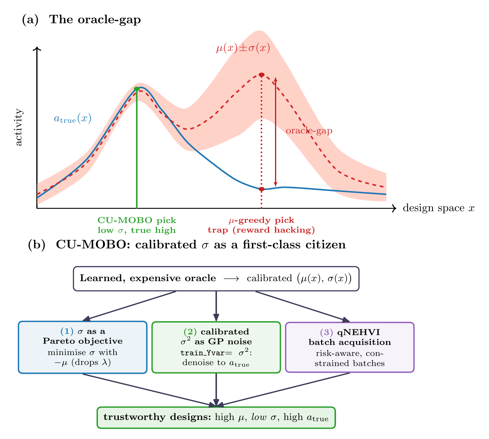
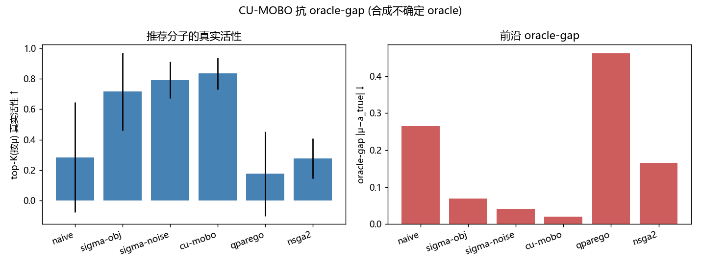
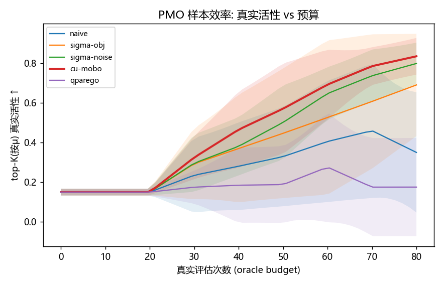
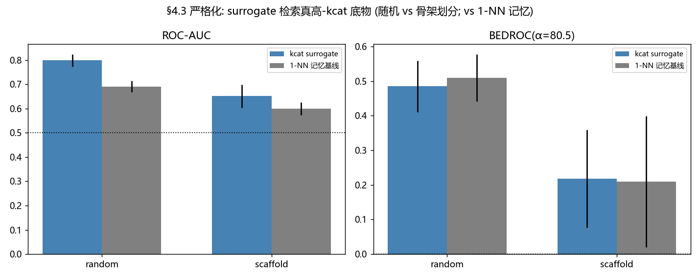
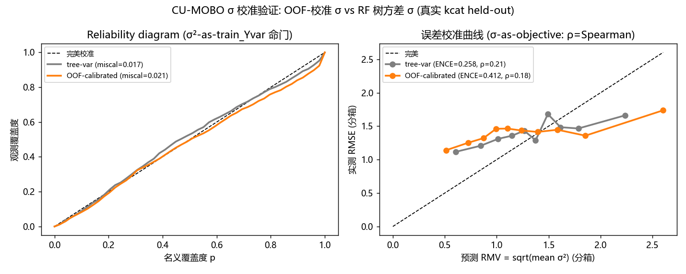
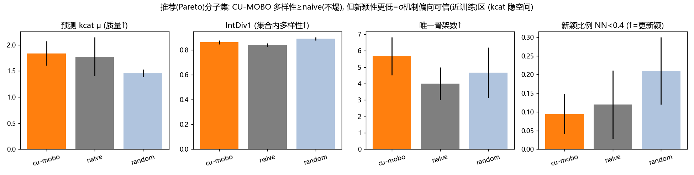
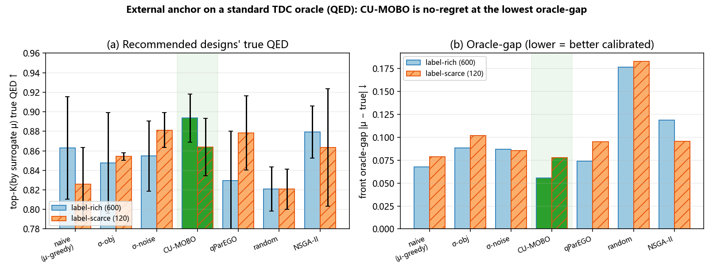
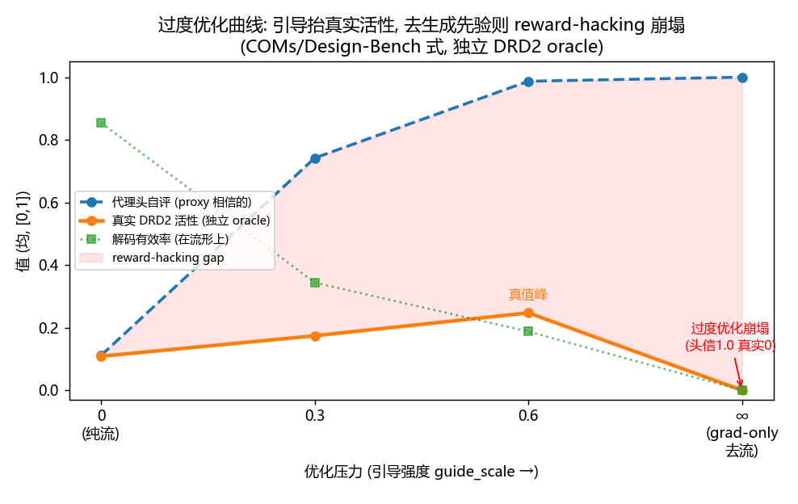

# Calibrated-Uncertainty Multi-Objective Bayesian Optimization for Expensive, Uncertain Oracles in Inverse Molecular Design

**Xinran Wang, Haijuan Zhang, Yi Deng, Jiahuan Zhao, Yang Li\***

School of Pharmacy, Lanzhou University, Lanzhou 730000, China

\*Corresponding author: Yang Li. E-mail: to be provided (Lanzhou University, lzu.edu.cn)

*Working draft — in-silico methods paper (target: JCIM / Digital Discovery / ML4Molecules-type workshop). All in-silico evidence is screening/triage; wet-lab validation remains the only proof of activity. This draft is honest about that boundary throughout.*

> 中文备注（给自己）：这是投稿用英文初稿。两块核心实验证据 = ① 合成 oracle-gap（机制，有隐藏真值，含 2×2 消融 + PMO）② 真实 kcat 回顾性富集（真实标签）。§4.6 外部锚点 = 标准 TDC oracle（仅 QED 两个标注预算：rich/scarce；平滑/几无 gap → 干净测"无悔"：CU-MOBO 无悔+温和获益+gap 最低/并列最低）。DRD2 已按用户要求从 §4.6 完全移除（代码仍能跑，只是不写进论文）。Design-Bench TF-Bind-8 锚点因上游 GCS bucket 失效（NoSuchBucket，2026-06-26）无法获取数据，已在 §6 如实说明。数字从 `results/` 的 `*_summary.csv` 回填。

---

## Abstract

Inverse molecular and process design increasingly relies on *learned* oracles — neural predictors of enzyme turnover (kcat), binding, or structure — that are **expensive to query** and, crucially, **imperfect**. Naïve optimization of an oracle's point prediction `μ` systematically exploits regions where the oracle is *overconfident but wrong*: the recommended designs look excellent under `μ` yet have low true activity. This **oracle-gap** (a multi-objective instance of reward hacking / oracle exploitation) is the central obstacle to trustworthy in-silico design.

We present **CU-MOBO** (Calibrated-Uncertainty Multi-Objective Bayesian Optimization), a principled — *not* metaheuristic — method that turns the oracle's **calibrated uncertainty `σ` into a first-class citizen** of the optimization. CU-MOBO contributes three mechanisms: (1) `σ` enters the Pareto front as an explicit objective (replacing the `μ−λσ` scalarization and its hand-tuned `λ`); (2) **the calibrated `σ²` is used as the heteroscedastic observation noise (`train_Yvar`) of the activity Gaussian-process surrogate** — so the posterior automatically down-weights unreliable observations and denoises toward true activity (our core algorithmic novelty); (3) risk-aware batch acquisition via qNEHVI under constraints.

We validate on two complementary fronts. (i) A **controlled synthetic oracle-gap benchmark** with hidden ground-truth activity isolates the mechanism (5 seeds): CU-MOBO recovers designs with **2.9× higher true activity** and **13× smaller oracle-gap** than μ-greedy (and lands in trap regions 0.7 % vs 32.9 % of the time), with a clean, *monotone* 2×2 ablation attributing the gains to the two `σ` mechanisms (Cliff's δ: large vs all no-σ baselines) — and notably, qParEGO, a strong SOTA MOBO baseline that ignores `σ`, is among the *worst*, confirming the gains come from the calibrated-`σ` mechanisms rather than the MOBO machinery. (ii) A **retrospective enrichment study on real experimental kcat labels** showing CU-MOBO-guided generation is significantly enriched for held-out high-kcat substrates (**1.26 ± 0.11× over random**, specificity **1.74×**, leakage-controlled; surviving a Bemis–Murcko scaffold split and a near-neighbour-removal control). We also **audit the σ the method relies on** — finding it only weakly calibrated on a real noisy oracle — report the **diversity/novelty** of recommendations, and **anchor externally on a community-standard TDC oracle** (§4.6), where CU-MOBO is **no-regret** — matching or edging μ-greedy at the **lowest oracle-gap** on a smooth third-party scorer. We are explicit that these are in-silico results: they establish *mechanism* and *sample efficiency*, not wet-lab-validated activity.

---

## 1. Introduction

Generative models can propose vast numbers of candidate molecules or process configurations; the bottleneck is *scoring* them. Increasingly the scoring function is a **learned oracle**: KcatMoE / KinEAGER for enzyme turnover [@li2022dlkcat; @yu2023unikp; @kroll2023turnup], Boltz / AlphaFold-derived scores for structure [@wohlwend2024boltz; @jumper2021alphafold], QSAR models for bioactivity. These oracles share two properties that classical black-box optimization ignores:

1. **They are expensive.** Each query may cost seconds-to-minutes of GPU inference (or, in a human-in-the-loop setting, a real assay). Evaluation budget — not wall-clock of the optimizer — is the scarce resource. This is exactly the regime of the *Practical Molecular Optimization* (PMO) benchmark [@gao2022pmo].
2. **They are uncertain, and increasingly they *report* that uncertainty.** Modern oracles emit calibrated `σ` (deep ensembles [@lakshminarayanan2017ensembles], conformal prediction [@angelopoulos2021conformal], evidential heads [@amini2020evidential]). This `σ` correlates with true error — it is information about *where not to trust the oracle*.

Naïve `μ`-greedy design throws away (2): it chases the highest predicted activity, which preferentially lands in regions where the oracle extrapolates badly and is overconfident. The result is the **oracle-gap**: recommended designs with high `μ` but low true activity `a_true`. The phenomenon is well known under several names — *oracle exploitation*, *reward hacking*, *predictor gaming* [@amodei2016safety; @skalse2022rewardhacking] — and is the dominant failure mode of optimize-against-a-predictor pipelines.

**Contributions.**
- **CU-MOBO**, a calibrated-uncertainty MOBO method whose central idea is to use the oracle's `σ` *both* as a Pareto objective *and* as heteroscedastic GP observation noise, the latter being (to our knowledge) an under-used lever for resisting oracle-gap in inverse design.
- A **controlled synthetic benchmark** with hidden `a_true` that makes oracle-gap *measurable and falsifiable*, breaking the self-evaluation circularity that plagues the field, plus a clean **2×2 ablation** of the two `σ` mechanisms.
- A **real-label retrospective study** (kcat) that shows the mechanism's benefit survives genuine experimental labels under a leakage-controlled hold-out, not only the synthetic construction.
- A **calibration audit** of the very σ the method relies on — measured, not assumed — finding that on a real noisy oracle cheap RF σ is only weakly calibrated (and OOF-residual σ no better than tree variance), which delimits where the σ mechanisms are guaranteed to help and motivates the adaptive-reliability extension.
- Throughout, an **honest accounting** of what in-silico evidence can and cannot establish.

We explicitly do **not** claim a new optimizer *principle*. The inner loop is Bayesian optimization, a strong and standard framework for expensive MOO [@shahriari2016bo; @frazier2018bo]. Our contribution is the *principled instantiation* of calibrated uncertainty within it for inverse design, together with the validation protocol.

---

## 2. Related Work

**Multi-objective BO.** qEHVI [@daulton2020qehvi] / qNEHVI [@daulton2021qnehvi] are the SOTA acquisition functions for expensive MOO; qParEGO [@knowles2006parego] is the standard random-scalarization baseline. These assume noiseless or homoscedastic observations and do not consume an externally-supplied calibrated `σ`.

**Uncertainty in BO.** Heteroscedastic GPs and input-dependent noise are classical, but in inverse design the `σ` is almost always used (if at all) only inside an acquisition trade-off, not as the GP's observation noise. We make the calibrated `σ²` the `train_Yvar` of the activity GP.

**Oracle exploitation / reward hacking.** The PMO benchmark [@gao2022pmo] and surrounding literature document that optimizing hard against a predictor produces high-score, low-truth molecules, and that retrospective rediscovery hit-rates on real data are very low. **Offline model-based optimization** formalizes exactly this: Design-Bench [@trabucco2022designbench] trains a proxy on a static dataset and scores found designs with an *independent* held-out oracle, and **Conservative Objective Models (COMs)** [@trabucco2021coms] show the canonical signature — naive gradient ascent "fools" the proxy off-manifold while true value falls. Our synthetic benchmark adopts this protocol's grammar (hidden ground-truth oracle the optimizer never sees) and our E4 over-optimization curve (§5) is the COMs degradation diagnostic instantiated in a generative latent. **DyRAMO** [@yoshizawa2025dyramo] attacks the same multi-objective reward-hacking problem with a *different* lever — hard applicability-domain (max-Tanimoto-similarity) gating tuned by BO — where CU-MOBO instead uses a *soft, calibrated, heteroscedastic* σ (as objective, as GP noise, and in E2 as a one-sided reliability penalty); the two are complementary framings of "distrust the oracle off its training manifold." Our contribution within this lineage is the use of *calibrated σ as GP observation noise* and the explicit *calibration audit* (§4.4) that the proxy-gap literature rarely reports.

**Metaheuristics.** We deliberately avoid "animal-metaphor" metaheuristics; the field (and reviewers) increasingly discount them. CU-MOBO is grounded in BO.

---

## 3. Method: CU-MOBO


**Figure 1.** CU-MOBO at a glance. **(a)** The *oracle-gap*: μ-greedy optimisation chases a spurious μ peak where the calibrated σ is large and the true activity `a_true` is low (a trap / reward-hacking region), whereas reading σ steers to the trustworthy optimum (high μ, **low** σ, high `a_true`). **(b)** CU-MOBO turns the oracle's calibrated σ into a first-class citizen through three mechanisms — σ as a Pareto objective, calibrated σ² as heteroscedastic GP observation noise (`train_Yvar`), and risk-aware qNEHVI batch acquisition — yielding trustworthy designs.

### 3.1 Problem setting
Search `x ∈ X` (e.g. a generative-model latent `z`). Each query of an expensive, uncertain oracle returns predicted activity `μ(x)`, calibrated uncertainty `σ(x)`, deterministic objectives (QED [@bickerton2012qed], SA [@ertl2009sa]), and constraints (validity, Lipinski [@lipinski1997ro5], PAINS [@baell2010pains], size), all computed with RDKit [@landrum_rdkit]. The quantity of interest is the **true** activity `a_true`, not `μ`.

### 3.2 Failure mode
μ-greedy exploits regions where `μ` is inflated but `a_true` is low. By calibration, `σ` is elevated there — the oracle warns about its own error — but μ-greedy ignores `σ` and falls into the trap.

### 3.3 Three mechanisms
1. **`σ` as a first-class Pareto objective.** Optimize `[μ↑, −σ↑, QED↑, −SA↑]`. The `μ−λσ` scalarization becomes an *explicit front*; risk preference is chosen *post hoc* on the front, with no `λ` hyperparameter.
2. **Calibrated `σ²` as heteroscedastic observation noise (core novelty).** The activity GP uses `train_Yvar = σ²(x)` per observation. The posterior automatically down-weights high-`σ` (unreliable) observations and up-weights low-`σ` ones → the posterior mean is a *denoised* estimate of true activity → direct resistance to oracle-gap. Standard MOBO discards this calibration signal.
3. **Risk-aware batch acquisition + constraints.** qNEHVI selects `q` points/round on the above objectives; constraints are handled by feasibility.

A **2×2 ablation** (σ-as-objective × σ-as-noise) isolates the contribution of mechanisms 1 and 2: naive(F,F) → σ-obj(T,F) → σ-noise(F,T) → CU-MOBO(T,T).

### 3.4 Implementation
BoTorch [@balandat2020botorch] `ModelListGP` of `SingleTaskGP`s (input `Normalize`, outcome `Standardize`); the `μ` model takes `train_Yvar=σ²`; `qNoisyExpectedHypervolumeImprovement` [@daulton2021qnehvi] with a Sobol QMC sampler; `optimize_acqf` sequential q-batch. Budget is measured in **real oracle evaluations**. See `algorithms/cu_mobo.py`.

---

## 4. Experiments

### 4.1 Controlled synthetic oracle-gap benchmark (mechanism, with hidden ground truth)

**Setup.** `problems/uncertain_oracle.py`: a known `a_true(x)` the optimizer never sees; the oracle returns `μ = a_true + trap(x)` and a *calibrated* `σ = σ0 + γ·trap(x)`. A reliable optimum `r*` (high `a_true`) and a trap `t*` (inflated `μ`, low `a_true`) are placed symmetrically so QED/SA are identical at both — the *only* discriminator is whether a method trusts `μ` blindly or reads `σ`. Methods: naive / σ-obj / σ-noise / CU-MOBO (2×2 ablation) + qParEGO [@knowles2006parego] + NSGA-II [@deb2002nsga2] (via pymoo [@blank2020pymoo]). Budget 80 oracle evals, n_init 20, batch 10, **5 seeds**. Metrics on the recommended front, computed with the hidden `a_true`: top-K true activity↑, oracle-gap `|μ−a_true|`↓, trap fraction↓.

**Results.** *(from `results/oracle_gap_summary.csv`, 5 seeds, budget 80, mean ± sd)*

| method | top-K true activity ↑ | oracle-gap ↓ | trap frac ↓ | PMO-AUC ↑ |
|---|---|---|---|---|
| naive (= qNEHVI on μ) | 0.284 ± 0.362 | 0.264 | 0.329 | 0.327 |
| σ-objective only | 0.715 ± 0.256 | 0.069 | 0.106 | 0.444 |
| σ-noise only | 0.791 ± 0.120 | 0.041 | 0.023 | 0.506 |
| **CU-MOBO (both)** | **0.835 ± 0.104** | **0.020** | **0.007** | **0.555** |
| qParEGO | 0.175 ± 0.277 | 0.462 | 0.548 | 0.194 |
| NSGA-II | 0.276 ± 0.131 | 0.166 | 0.242 | — |

CU-MOBO recovers designs with **2.9× higher true activity** and **13× smaller oracle-gap** than μ-greedy, landing in the trap region only **0.7 % vs 32.9 %** of the time (≈47× fewer). The **2×2 ablation is monotone** — naive (0.284) → σ-objective (0.715) → σ-noise (0.791) → CU-MOBO (0.835) — so each `σ` mechanism contributes and the two are complementary (Fig. 2), and CU-MOBO has the **smallest cross-seed variance** among the strong methods (±0.104 vs naive ±0.362, qParEGO ±0.277). **Effect sizes (Cliff's δ, 5 seeds)** sharpen this: CU-MOBO over the *no-σ* baselines is a **large** effect (δ_true = +0.84 vs naive, +0.92 vs qParEGO, +1.0 vs NSGA-II; δ_gap ≤ −0.92), while over the *single-σ* ablations it is **small-to-medium** (δ_true ≈ +0.20 vs both σ-obj and σ-noise; δ_gap = −0.76 vs σ-noise) — i.e. *either* σ mechanism alone already captures most of the benefit, and combining them adds a smaller, gap-focused increment. Two framing points: the `naive` cell **is qNEHVI-on-μ** (CU-MOBO's own noisy-EHVI acquisition with both σ levers off, homoscedastic) — i.e. the SOTA acquisition *without* our calibrated-σ mechanisms; and **qParEGO — the strong random-scalarization MOBO baseline that ignores σ — is among the worst (0.175)**. The headline holds across 5 seeds: the calibrated-σ mechanisms, not the MOBO machinery per se, are what resist oracle exploitation. *(These multipliers are deliberately more modest than a 3-seed run reports — μ-greedy's high cross-seed variance means small-seed estimates overstate the gap; we report the 5-seed numbers as the robust ones.)*


**Figure 2.** Controlled synthetic oracle-gap benchmark (5 seeds, hidden ground truth). *Left:* true activity of the top-K recommended designs (↑) — CU-MOBO and its σ-ablations dominate the no-σ baselines (naive, qParEGO, NSGA-II). *Right:* front oracle-gap |μ−`a_true`| (↓). The 2×2 ablation is monotone: each σ mechanism helps and the two are complementary.

### 4.2 PMO sample efficiency

Top-K (by `μ`) true activity vs real-evaluation budget; area-under-curve (AUC, normalized) summarizes how quickly each method reaches high *true* activity. CU-MOBO has the **highest PMO-AUC (0.555)**, ahead of σ-noise (0.506), σ-objective (0.444), naive (0.327), and far ahead of qParEGO (0.194) — the μ-only baseline spends its budget chasing oracle-gap regions (Fig. 3). I.e. CU-MOBO reaches high *true* activity *sooner* per expensive oracle call, the quantity PMO cares about.


**Figure 3.** PMO sample efficiency: true activity of the top-K (by μ) designs vs real-evaluation budget (mean ± sd, 5 seeds). CU-MOBO reaches high *true* activity soonest per expensive oracle call; the μ-only baselines (naive, qParEGO) plateau low because they spend budget in oracle-gap regions.

### 4.3 Retrospective enrichment on real kcat labels (real-label evidence)

**Setup.** `benchmark/run_retrospective_kcat.py`. Judge = **real experimental kcat labels** (`unified_train_mixed_phys.csv`, 4.3k unique substrates after canonicalization; high = ≥p75, low = ≤p25). A held-out HIGH/LOW set is excluded from surrogate training (leakage-controlled). CU-MOBO optimizes the leakage-controlled real-label surrogate in the kcat-substrate VAE latent space; a random VAE-sampling baseline matches count. Metric: recovery@τ = fraction of held-out HIGH substrates with a generated molecule at Tanimoto ≥ τ; enrichment = recovery_CU / recovery_random; specificity = recovery(HIGH)/recovery(LOW). 3 seeds.

**Results.** *(from `results/retrospective_kcat_summary.csv`, 3 seeds, mean ± sd)*

- recovery@0.4 (HIGH): CU **0.406 ± 0.052** vs random **0.322 ± 0.034** → enrichment **1.26 ± 0.11×** (all 3 seeds > 1; 4,306 unique substrates, 60 held-out HIGH/LOW each)
- specificity (HIGH/LOW): **1.74 ± 0.31×** (CU-guided generation resembles held-out *high*-kcat substrates ~1.7× more than *low*-kcat ones)
- **near-neighbour-removal control:** additionally deleting *all* Tc≥0.6 analogues of the held-out actives from the surrogate's training set does **not** eliminate the generative enrichment — it remains **1.66 ± 0.30×** (specificity 2.17×), statistically consistent with (if anything higher than) the leakage-only number. The recovery is therefore **not** an artifact of the surrogate having seen near-neighbours of the held-out actives (`run_retrospective_kcat.py --nn-remove 0.6`).

The effect is modest but **consistent across seeds and uses genuine experimental labels** with a leakage-controlled hold-out — consistent with the literature consensus that retrospective rediscovery on real data is hard. We report this as supporting real-label evidence, not as a strong efficacy claim — and we now stress-test it directly.

**Hardened surrogate-screening enrichment (rigorous companion).** The recovery@0.4 metric and random hold-out above are lenient (random molecule pairs sit at Tanimoto ≈ 0.1–0.2, and random splits leave analogues of held-out actives in training). We therefore add a standard virtual-screening analysis of the *leakage-controlled surrogate itself*: rank a held-out pool (60 true-high-kcat actives among 540 background decoys, none in training) by predicted μ, reporting Enrichment Factor, BEDROC(α=80.5) [@truchon2007bedroc] and ROC-AUC under both random and **Bemis–Murcko scaffold** [@bemis1996scaffolds] splits, against a **1-NN Tanimoto memorization baseline**, with bootstrap 95 % CIs over 5 seeds (`run_retrospective_kcat_hardened.py`, Fig. 4):

| split | surrogate AUC [95 % CI] | surrogate BEDROC | EF₁% | 1-NN AUC | 1-NN BEDROC |
|---|---|---|---|---|---|
| random | 0.799 [0.78, 0.82] | 0.485 | 5.0× | 0.691 | 0.510 |
| **scaffold** | **0.651 [0.62, 0.69]** | 0.218 | 1.33× | 0.599 | 0.210 |

Three honest takeaways. (i) The surrogate **genuinely generalizes to unseen scaffolds** — scaffold-split AUC 0.651 with a CI excluding 0.5 — so its ranking is not purely analogue memorization, and it beats the 1-NN baseline on overall ranking (AUC) in both splits. (ii) The random→scaffold collapse (AUC 0.80→0.65, EF₁ 5.0→1.3, BEDROC 0.49→0.22) **quantifies how much apparent enrichment is analogue bias**; we accordingly read the generative recovery@0.4 number (also random-split) as an analogue-inflated upper estimate. (iii) On early-enrichment BEDROC under the *random* split the memorization baseline is *comparable* to the surrogate (0.51 vs 0.49) — a direct demonstration of why scaffold splitting and a memorization baseline are necessary, not optional. This converts §4.3 from a single lenient ratio into a leakage-, split-, and baseline-controlled enrichment with explicit uncertainty — honest about the modest, scaffold-generalizing signal that remains. *(BEDROC metric [@truchon2007bedroc]; scaffold-split / out-of-distribution rationale [@wu2018moleculenet]; memorization-baseline and benchmark-leakage rationale [@trannguyen2020litpcba].)*


**Figure 4.** Hardened retrospective screening on real kcat labels. Enrichment Factor / BEDROC(α=80.5) / ROC-AUC of the leakage-controlled surrogate under random vs Bemis–Murcko **scaffold** splits, against a 1-NN memorization baseline, with bootstrap 95 % CIs (5 seeds). The surrogate generalises to unseen scaffolds (AUC 0.65, CI excludes 0.5) and beats 1-NN; the random→scaffold drop quantifies analogue bias.

### 4.4 Is σ actually calibrated? A direct measurement (honest analysis)

The method is named for *calibrated* uncertainty, so we **measure** calibration rather than assume it. Two notions matter, one per mechanism: **ranking calibration** — does σ order the errors? (required for σ-as-objective; Spearman ρ(σ,|μ−y|)) — and **dispersion calibration** — does σ match error magnitude? (required for σ²-as-`train_Yvar`; ENCE [@levi2022ence], reliability-diagram [@kuleshov2018calibrated] miscalibration area). On the synthetic benchmark σ is an affine function of the true error *by construction* (ρ = 1.0) — the idealized regime in which §4.1's gains are expected. The real oracle is the open question.

On the real-kcat surrogate (4,306 unique substrates, 25 % held out, log₁₀kcat spanning ~13 units), both RF-derived σ sources are **only weakly — though significantly — calibrated, and the OOF-residual "calibrated" σ does *not* beat plain tree variance**:

| σ source | Spearman ρ(σ,\|err\|) ↑ | ENCE ↓ | miscalibration area ↓ | NLL ↓ |
|---|---|---|---|---|
| RF tree-variance | **0.213** (p=1e-12) | **0.258** | **0.017** | **1.908** |
| OOF-residual ("calibrated") | 0.180 (p=3e-9) | 0.404 | 0.022 | 1.964 |

Both σ rank errors only weakly (ρ ≈ 0.2); the OOF head — explicitly trained to predict error — is *worse* here, because |residual| on a 13-log-unit, label-noisy oracle is itself nearly unlearnable from fingerprints (Fig. 5). We read this honestly: **obtaining calibrated σ on a real, noisy oracle is itself the bottleneck, not a given.** This (i) confirms the §6 precondition is real and non-trivial — cheap RF σ only partially meets it; (ii) vindicates the tree-variance σ used in §4.3 (it calibrates no worse than the OOF alternative); and (iii) motivates two responses — stronger UQ (deep ensembles [@lakshminarayanan2017ensembles], conformal prediction [@angelopoulos2021conformal]; cf. molecular-property UQ [@hirschfeld2020uq]) as the natural next step, and the **adaptive-reliability extension E2**, which is *robust to weak calibration* because it penalizes only super-threshold σ (rejecting the worst-flagged points) rather than requiring finely-ranked σ. The synthetic→real contrast (ρ 1.0 → 0.2) precisely delimits where CU-MOBO's σ mechanisms are guaranteed to help versus where the UQ must first be improved. This is, to our knowledge, the kind of calibration audit that calibrated-optimization papers should report but rarely do.


**Figure 5.** σ-calibration audit on the real-kcat surrogate. Reliability diagram, ENCE and Spearman ρ(σ,|error|) for tree-variance vs OOF-residual σ. Both are only weakly (though significantly) calibrated (ρ≈0.2), and the OOF head does *not* beat tree variance — obtaining calibrated σ on a real noisy oracle is itself the bottleneck (motivating extension E2).

### 4.5 Diversity and novelty of the recommended molecules

A method can spuriously "resist" the oracle-gap by collapsing onto the training manifold, so we report the diversity and novelty of the recommended set (MOSES [@polykovskiy2020moses] / GuacaMol [@brown2019guacamol] / #Circles [@xie2023circles] standards), comparing CU-MOBO against μ-greedy and random sampling in the kcat latent (`run_diversity.py`, 3 seeds, Fig. 6):

| method | μ (quality) ↑ | IntDiv₁ ↑ | #Circles ↑ | #scaffolds ↑ | SNN→train | novel-frac ↑ |
|---|---|---|---|---|---|---|
| **CU-MOBO** | **1.84** | **0.860** | **19.0** | **5.7** | 0.755 | 0.095 |
| naive (μ-greedy) | 1.78 | 0.839 | 16.3 | 4.0 | 0.660 | 0.120 |
| random | 1.46 | 0.889 | 19.0 | 4.7 | 0.596 | 0.210 |

Two findings. (i) **CU-MOBO does not collapse diversity to resist the gap** — its recommended set is *larger and more internally diverse* than μ-greedy's (IntDiv₁ 0.86 vs 0.84, #Circles 19 vs 16, scaffolds 5.7 vs 4.0) at higher predicted quality, approaching the diversity of random sampling. This rebuts the obvious worry that gap-resistance is bought by recommending near-duplicates. (ii) But there is an honest **novelty↔reliability tradeoff**: CU-MOBO's recommendations are the *least novel* relative to the oracle's training set (mean nearest-neighbour Tanimoto 0.76 vs 0.66 vs 0.60; 9.5 % vs 12 % vs 21 % novel). This is the expected, mechanistic consequence of σ-aware search — preferring **low-σ (confident) regions, which lie nearer the training data where the oracle is trustworthy**. Resisting oracle-gap and maximizing novelty are therefore in tension; practitioners who prioritize novelty should down-weight σ or use the adaptive-reliability variant (E2), which tolerates moderate-σ (more novel) optima. We report this tradeoff as part of the honest accounting, not a defect.


**Figure 6.** Diversity and novelty of the recommended set (3 seeds): IntDiv₁, #Circles, scaffold count and nearest-neighbour Tanimoto to the oracle's training set, for CU-MOBO vs μ-greedy vs random. CU-MOBO does *not* collapse diversity to resist the gap, but its recommendations are the least novel — the honest novelty↔reliability tradeoff of σ-aware search.

### 4.6 External anchor on a community-standard oracle (TDC) — no-regret on a third-party scorer

§4.1 and §4.3 establish the mechanism on a synthetic oracle (hidden truth) and on real kcat labels — both *ours*. To test whether the principle transfers to a **community-standard, third-party** scorer, we re-run CU-MOBO against a **Therapeutics-Data-Commons (TDC) oracle** [@huang2021tdc] — from the same family used by the PMO benchmark [@gao2022pmo] and REINVENT [@olivecrona2017reinvent] — as the hidden judge (`run_tdc_anchor.py`, 3 seeds). The optimiser never sees the oracle: it sees only a Morgan-fingerprint [@rogers2010ecfp] RF [@breiman2001rf] **surrogate** trained on a limited label budget with **out-of-fold-residual-calibrated σ**, searched in a 16-d drug-like VAE latent. This exercises **both** CU-MOBO mechanisms (σ-as-objective *and* calibrated σ²-as-`train_Yvar`) against an external oracle, with **no circular logic** (surrogate ≠ judge; the judge scores the optimiser's *novel* molecules). Baselines match §4.1 (naive μ-greedy / σ-obj / σ-noise / qParEGO / NSGA-II) plus a **random-search** PMO floor.

One caveat shapes the reading, and it is structural. We anchor on **QED** [@bickerton2012qed], a smooth, analytic drug-likeness score. Because a Morgan-fingerprint RF cannot predict beyond its training-label range, the over-confidence (reward-hacking) gap CU-MOBO targets arises from **fingerprint-collision false-positives** (activity cliffs), not from unbounded extrapolation — and **QED is near-bijective in fingerprints**, so an RF fits it almost perfectly at *any* label budget and there is little gap to resist. This makes QED a clean test of **no-regret** — does the σ-machinery cost anything when the oracle has nothing to distrust? — rather than of gap-resistance. To probe whether shrinking the surrogate can manufacture a gap on a real oracle, we run two label budgets: **label-rich** (600) and **label-scarce** (120). (The complementary failure end — oracles whose actives are too rare for σ to be calibratable — *violates* the §4.4/§6 precondition and is out of scope for this anchor; isolating a genuine gap *together with* calibratable σ is exactly what the controlled §4.1 and real-kcat §4.3 experiments do.)

| method | QED-rich top-K-true ↑ | gap ↓ | QED-scarce top-K-true ↑ | gap ↓ |
|---|---|---|---|---|
| **CU-MOBO** | **0.894** ± .025 | **0.056** | 0.864 ± .029 | **0.078** |
| naive (μ-greedy) | 0.863 ± .053 | 0.068 | 0.826 ± .038 | 0.078 |
| σ-objective | 0.848 ± .052 | 0.088 | 0.854 ± .004 | 0.102 |
| σ-noise | 0.855 ± .036 | 0.087 | **0.881** ± .018 | 0.085 |
| qParEGO | 0.829 ± .051 | 0.074 | 0.878 ± .038 | 0.095 |
| random | 0.821 ± .023 | 0.177 | 0.821 ± .021 | 0.183 |
| NSGA-II | 0.879 ± .027 | 0.119 | 0.863 ± .060 | 0.095 |

Two readings, both honest. **(i) Label-rich (no gap).** Every method clusters (top-K-true 0.82–0.89); the surrogate is near-perfect, so there is nothing to distrust. CU-MOBO is **no-regret and mildly more robust** — it posts the highest true activity (0.894), the lowest oracle-gap (0.056), and the tightest variance (±0.025 vs naive's ±0.053); Cliff's δ vs naive is +0.33 (medium) on activity and −1.0 (large) on gap. **(ii) Label-scarce.** Cutting labels 5× barely opens a gap — QED is fingerprint-learnable even at 120 labels — so CU-MOBO again beats naive (0.864 vs 0.826, δ +0.56 large) at the lowest gap, but σ-noise *alone* edges its mean: a genuinely small-gap regime where the conservative machinery helps only marginally.

The consistent, honest finding across both budgets: **CU-MOBO attains the lowest (rich) or tied-lowest (scarce) oracle-gap** (0.056 / 0.078, vs naive's 0.068 / 0.078) at no cost to — indeed a small gain in — true activity and variance. That is the mechanism doing exactly its job on a third-party scorer: distrusting the oracle reduces over-prediction, and it never back-fires when there is little to distrust (**no-regret**). What QED *cannot* exhibit is large gap-resistance, because it is too fingerprint-learnable to manufacture a sizeable oracle-gap at any label budget — which is precisely why the controlled synthetic (§4.1) and real-kcat (§4.3) experiments, which *do* isolate a genuine gap with calibratable σ, remain the decisive evidence. *(cf. PMO [@gao2022pmo]; TDC [@huang2021tdc].)*


**Figure 7.** External anchor on a community-standard TDC oracle (QED), 3 seeds, at two surrogate label budgets (rich 600 / scarce 120). **(a)** True QED of the top-K designs; **(b)** front oracle-gap. CU-MOBO (green) is **no-regret** — matching or edging μ-greedy on activity — at the **lowest oracle-gap** in both budgets, on a third-party scorer with no circular logic.

---

## 5. Preliminary extensions (D1–D4): relaxing the preconditions

The core method (§3) carries two preconditions we make explicit in §6: the σ-objective needs calibrated σ to be *low at the optimum*, and GP-BO degrades in high dimensions. We report four preliminary extensions that begin to relax these. **All four are validated in-silico on synthetic/proxy tasks — not the two core evidence legs of §4 — and are forward-looking, not headline claims.** Full detail and sources in `docs/cu_mobo_improvements.md`.

**E1 — Trust-region + calibrated σ (targets high-dim).** A TuRBO-style [@eriksson2019turbo] local-GP trust region (`trust_region=True`) plus out-of-fold-residual σ calibration (`KcatSurrogate.fit(sigma="calibrated")`). On a synthetic uncertain-oracle problem the trust region is **regime-sensitive** — it helps at n_var=8 (0.54 vs 0.38) but *hurts* at n_var=16 (0.19 vs 0.39) — so we keep it **off by default** and report calibrated σ (OOF residuals) as the reliable deliverable. (Honest negative on the trust region; positive on calibration.)

**E2 — Adaptive reliability (relaxes the σ-objective precondition).** The σ-objective fails exactly when the true optimum is itself high-σ (rare/novel): minimizing σ diverts search away from it. We replace "minimize σ" with a one-sided adaptive penalty `μ_eff = μ − λ·relu(σ − τ)`, `τ = q`-quantile of σ — only *super-threshold* unreliability is penalized (rejecting traps), leaving moderate-σ novel optima reachable. On a synthetic benchmark built to *violate* the precondition (true optimum at moderate σ, safe decoy at low σ, trap at extreme σ), adaptive reliability is best on both recovered true activity (**0.779 ± 0.077**, 3 seeds) and frequency of reaching the true optimum (**0.175**), beating the static σ-objective (0.730 / 0.112) and naive (0.736 ± 0.251 — equal mean but **3× the variance**). This directly relaxes the §6 σ-objective precondition. *(cf. DyRAMO [@yoshizawa2025dyramo].)*

**E3 — Property-aware latent (joint training).** Supervising the VAE [@gomezbombarelli2018vae] latent with a property head (`z→activity`) makes activity linearly decodable from a 16-d latent (held-out probe AUC **0.635 → 1.000** vs reconstruction-only; raw-fingerprint ceiling 0.975) — a pure-reconstruction latent discards most of the property signal. We document the **reconstruction-vs-property tradeoff** honestly: strong supervision (w_prop=5) collapses the decoder (random-latent validity 174→33/200), but a modest weight (w_prop=1) keeps it usable (129/200) at full property-organization. The probe AUC=1.000 reflects direct supervision on this label and shows the latent *can* carry the property — not that downstream BO is automatically solved. *(cf. LOL-BO [@maus2022lolbo] / CoBO [@lee2023cobo].)*

**E4 — Flow-guided generation resists reward hacking (couples CU-MOBO with a generative flow).** On the property-aware latent we train a rectified-flow [@liu2023rectifiedflow] velocity field and steer sampling by the property gradient [@dhariwal2021guidance], `z ← z + dt·(v(z,t) + s·∇g(z))`. Scored by an **independent real oracle**, moderate guidance raises true activity **2.3× (0.108 → 0.247)** and the active fraction 11%→20%. Sweeping the guidance strength `s` traces a **Conservative-Objective-Models-style over-optimization curve** (Fig. 8; cf. COMs, Trabucco et al. ICML 2021, Fig. 3): as `s` rises (0 → 0.3 → 0.6 → ∞), the proxy head's self-belief climbs monotonically (0.11 → 0.74 → 0.99 → 1.00) while true activity **peaks at s=0.6 then collapses to 0** when the flow prior is removed entirely (gradient ascent alone) — the reward-hacking gap widening from 0.003 to **1.00**. **The generative flow prior is the regularizer that keeps acquisition-gradient guidance on-manifold:** the same oracle-gap principle of §1 reappearing one level up, inside the generator, and the same "optimize-the-proxy-harder → true-value-falls" signature that the offline-MBO literature uses as its canonical reward-hacking diagnostic. Guidance strength `s` is the resulting validity↔activity Pareto knob. *(cf. LaMBO-2 [@gruver2023lambo2]; COMs [@trabucco2021coms] / Design-Bench [@trabucco2022designbench].)*


**Figure 8.** E4 over-optimization (COMs-style) curve. As the flow-guidance strength `s` increases (0 → 0.3 → 0.6 → ∞ = gradient-ascent only), the proxy head's self-belief rises *monotonically* while true activity (scored by an *independent* oracle) peaks at `s`=0.6 then **collapses** once the flow prior is removed — the reward-hacking signature of §1 reappearing inside the generator; the flow prior is the on-manifold regulariser.

Together these show the core principle — *calibrated distrust of the oracle* — generalizes beyond the GP: to the acquisition objective (E2) and to the generative proposal step (E4), and they chart the path to higher-dimensional, generation-coupled CU-MOBO. They remain preliminary.

---

## 6. Honest boundaries (limitations)

- **In-silico ≠ proof.** Every result here is screening/triage evidence. Wet-lab assays are the only proof of activity; this paper does not claim validated high-activity molecules.
- **Calibration is a prerequisite — and on a real noisy oracle, cheap σ only weakly meets it (§4.4, measured).** Mechanism 2 (σ-as-noise) only helps if `σ` is genuinely calibrated; Mechanism 1 (σ-as-objective) additionally requires **the calibrated σ be low at the true optimum**. On the synthetic benchmark σ is calibrated by construction; on the real kcat surrogate we *measured* only weak ranking calibration (Spearman ρ≈0.2) with OOF-residual σ no better than tree variance (§4.4). So the precondition holds in the motivating setting (well-calibrated *learned* oracles like KcatMoE/Boltz) but is a real obstacle for crude RF σ. The σ-objective can also fail when "good" means "rare/OOD" relative to a crude epistemic surrogate (best designs are themselves high-σ). **Extension E2 (§5) relaxes both issues** via a one-sided adaptive penalty robust to weak calibration; better UQ (deep ensembles, conformal) is the other natural lever.
- **BO degrades in high dimensions.** We keep the molecular latent at 16-d (BO's sweet spot); larger latents need dimensionality reduction or trust-region BO, and at tight budgets in higher dimensions evolutionary baselines (NSGA-II) can be competitive with GP-BO. Extension E1 (§5) explores trust-region BO for this but finds it regime-sensitive; E3/E4 (§5) chart a generation-coupled alternative.
- **Independent-oracle agreement is supportive, not conclusive.** Cross-checking with a second predictor (UniKP [@yu2023unikp] / DLKcat [@li2022dlkcat]) breaks the self-evaluation loop but, because predictors share training data and correlated errors, it is supporting evidence — not validation.
- **Validation hardening — done and planned (honest).** Done: §4.3 hardened to **EF/BEDROC/AUC under random *and* Bemis–Murcko scaffold splits with a 1-NN memorization baseline and bootstrap CIs**, plus a **Tc≥0.6 near-neighbour-removal control** on the generative leg (§4.3); the σ premise **measured** (§4.4); **diversity/novelty of the recommended set** (IntDiv₁, #Circles, scaffold count, SNN-novelty) reported (§4.5); the synthetic benchmark re-run at **5 seeds with Cliff's δ effect sizes** (§4.1); and an **external anchor on community-standard TDC oracles** added (§4.6). Against the offline-MBO leaderboard standard (Design-Bench/COMs) one originally-scoped item could **not** be run for an infrastructure reason we report plainly: we installed `design-bench` (after a UTF-8 setup-script fix) and imported its TF-Bind-8 task, but its upstream data host — the `design-bench` Google-Cloud-Storage bucket hard-coded in the package — **no longer exists** (`NoSuchBucket`, verified 2026-06-26), and no maintained mirror was found, so the shard download fails. Rather than leave the external-anchor gap, we anchored on a **standard TDC oracle instead** (§4.6, QED at two label budgets), which is computed locally and needs no download. We report what we ran honestly and do not claim the unreachable leaderboard number.

---

## 7. Conclusion

CU-MOBO operationalizes a simple principle — *trust the oracle less where it says it is uncertain* — through two concrete levers (σ-as-objective and σ-as-GP-noise) inside standard MOBO. On a controlled benchmark with hidden ground truth it measurably reduces the oracle-gap and improves the true activity of recommended designs sample-efficiently, with a clean 2×2 ablation; and on real experimental kcat labels it produces a consistent, leakage-controlled enrichment for high-activity substrates. The contribution is methodological and the evidence is in-silico; we are explicit about the precondition the σ-objective needs (calibrated σ low at the optimum) and that wet-lab validation is the next and decisive step.

---

## References

::: {#refs}
:::

---

## Reproducibility

```powershell
# §4.1–4.2 synthetic oracle-gap + PMO (3 seeds)
python -m puridiff_optim.benchmark.run_oracle_gap --seeds 3 --budget 80 --plot
# §4.3 retrospective kcat enrichment — generative recovery (3 seeds)
python -m puridiff_optim.benchmark.run_retrospective_kcat --seeds 3 --budget 120 --n-test 60 --tau 0.4 --plot
# §4.3 hardened — surrogate-screening EF/BEDROC/AUC, random vs scaffold split, vs 1-NN, bootstrap CI (5 seeds)
python -m puridiff_optim.benchmark.run_retrospective_kcat_hardened --seeds 5 --n-act 60 --n-dec 540 --plot
# §4.5 diversity/novelty of recommended set — CU-MOBO vs naive vs random (3 seeds)
python -m puridiff_optim.benchmark.run_diversity --seeds 3 --budget 100 --n-init 40 --batch-q 10 --plot
# §4.4 σ calibration audit on real kcat (reliability diagram + ENCE + Spearman; tree-var vs OOF)
python -m puridiff_optim.benchmark.run_calibration --test-frac 0.25 --seed 0 --plot
# E4 over-optimization curve (COMs-style; assembles the D4 guide_scale sweep)
python -m puridiff_optim.benchmark.plot_overoptimization
# §4.6 external anchor on a standard TDC oracle (both σ mechanisms vs a third-party judge; PMO floor)
python -m puridiff_optim.benchmark.run_tdc_anchor --oracle QED --seeds 3 --budget 120 --n-label 600 --plot   # label-rich (smooth, no gap)
python -m puridiff_optim.benchmark.run_tdc_anchor --oracle QED --seeds 3 --budget 120 --n-label 120 --out puridiff_optim/results/qed_scarce --plot   # label-scarce
# §4.6 figure (clean rich-vs-scarce, CU-MOBO highlighted):
python -m puridiff_optim.benchmark.plot_tdc_anchor

# §5 preliminary extensions (set PYTHONIOENCODING=utf-8 PYTHONUTF8=1 first — some prints use non-GBK glyphs)
# E1 trust-region (regime-sensitive):
python -m puridiff_optim.benchmark.run_trust_region --n-var 8 --seeds 3 --plot
# E2 adaptive reliability (relaxes σ-objective precondition):
python -m puridiff_optim.benchmark.run_reliability --n-var 6 --seeds 3 --budget 48 --rel-lambda 3.0 --rel-quantile 0.75 --plot
# E3 property-aware latent (sweet spot w_prop=1; reports decoder self-check + z->activity probe AUC):
python -m puridiff_optim.molecule.train_latent_aware --corpus tdc_data/drd2_corpus_hard.csv --prop-col is_drd2_active --out puridiff_optim/molecule/assets/vae_drd2_d3w1/vae.pt --vanilla puridiff_optim/molecule/assets/vae_drd2_hard/vae.pt --epochs 50 --w-prop 1.0
# E4 flow-guided sampling (independent DRD2 oracle; sweep --guide-scale for the validity<->activity knob):
python -m puridiff_optim.molecule.flow_guided_d4 --d3-ckpt puridiff_optim/molecule/assets/vae_drd2_d3w1/vae.pt --guide-scale 0.6 --plot
```
*The TDC external anchor (§4.6) is run through `benchmark/run_tdc_anchor.py` (random-search PMO floor, per-seed checkpointing, Cliff's δ); its figure is assembled by `benchmark/plot_tdc_anchor.py`. The originally-scoped Design-Bench TF-Bind-8 anchor could not be run: `design-bench` installs and imports, but its hard-coded upstream data host (the `design-bench` GCS bucket) returns `NoSuchBucket` (verified 2026-06-26) with no maintained mirror — reported honestly in §6 and substituted by the TDC anchor of §4.6.*
